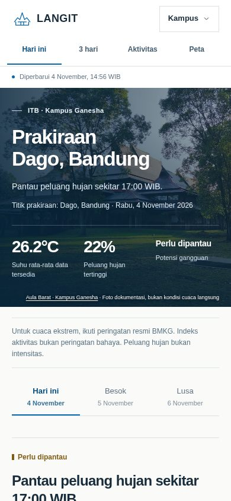
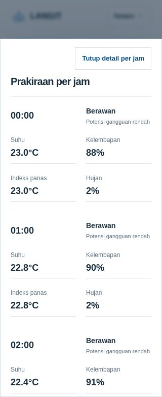

# Tata letak ponsel

Perubahan untuk lebar di bawah 768 px berada di `site_tools/mobile.css`.
Tampilan desktop tetap memakai stylesheet kampus dan editorial yang sama.

- Navigasi utama selalu terlihat. Pilihan kampus tetap tersedia di header.
- Tombol utama memiliki tinggi minimal 44 px. Label formulir tidak memicu
  pembesaran otomatis pada ponsel.
- Ringkasan dan teks pendukung menggunakan ukuran yang lebih terbaca.
  Pilihan variabel grafik dapat digulir mendatar.
- Ketukan pada grafik menampilkan nilai untuk jam terdekat. Data kosong
  tetap kosong; pembacaan tidak mengambil nilai dari jam lain.
- Dialog per jam memakai dua kolom nilai dan menahan gulir halaman di
  belakangnya. Tombol tutup tetap berada di bagian atas dialog.
- Peta tertanam diaktifkan melalui tombol Jelajahi peta. Tombol Kembali ke
  halaman memulihkan gulir halaman. Peta penuh tetap dapat dibuka.

Perhitungan prakiraan dan grid model tidak diubah. Pengujian browser mencakup
320, 360, 390, 430, 768, dan 1440 px; viewport ponsel menggunakan emulasi sentuh.

## Verifikasi rilis — 4 November 2026

- [PR #9](https://github.com/Marcooo20-D/weather-forecast/pull/9), sumber
  `0db94be3ab84c3df425479153a553a7b636124d4`.
- **74 tes offline dan 202 pemeriksaan Chromium lulus** pada kandidat akhir.
  Pengujian mencakup ketukan grafik, ukuran kontrol, dialog, navigasi,
  aktivasi/kembali dari peta, serta jalur kegagalan sumber.
- [Publikasi antarmuka](https://github.com/Marcooo20-D/weather-forecast/actions/runs/41824125314)
  dan [GitHub Pages](https://github.com/Marcooo20-D/weather-forecast/actions/runs/41824174021)
  berhasil. Commit terbit: `fd3a0bb2f8617bef46bde16e8e84da794e730f1f`.
- [Pemeriksaan HTTP](verification/mobile-layout-http.json) mencocokkan halaman,
  aset antarmuka, API lokasi, dan revisi manifest dengan tree publikasi.
- Tangkapan layar enam ukuran ditelaah. Desktop 1440 px dan situs publik
  diperiksa; label singkat serta kontrol peta khusus ponsel tetap tersembunyi
  di desktop. Mesin prakiraan dan adapter data numerik tidak berubah.

Contoh hasil pemeriksaan Chromium:

Pengujian memakai Chromium; pengujian Safari/WebKit dan perangkat fisik
belum dilakukan.
