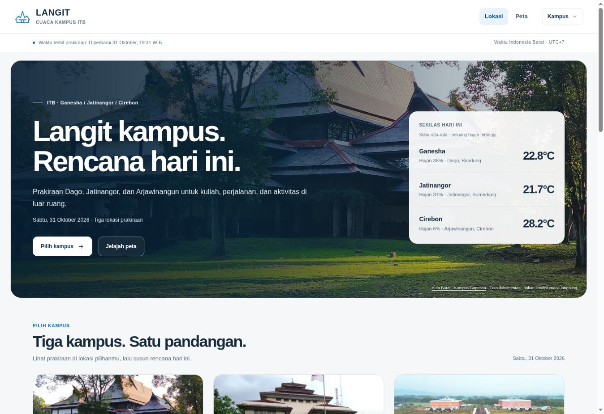

# Verifikasi LANGIT Campus v66

**Status 31 Oktober 2026:** LANGIT v66.0 sudah diterbitkan dan diperiksa di [website publik](https://marcooo20-d.github.io/weather-forecast/).

## Sumber dan perubahan

- PR: https://github.com/Marcooo20-D/weather-forecast/pull/5
- Head yang diuji sebelum merge: `cce8e3656d3084353aee1629bd91edf3ea3326c5`.
- Merge produksi: `c3fe00079d22f8e685175ff62ce0baf4d75c7dc8`.
- Foto asli Ganesha, Jatinangor dan Arjawinangun; aset WebP lokal responsif dan metadata sumber/hak.
- Antarmuka putih/kobalt, ringkasan cuaca ponsel, grafik dan dialog yang lebih rapi; enam parameter peta dengan target lebih besar dan legenda yang bisa dibuka di panel kontrol.
- Koordinat prakiraan, mesin cuaca, `public_data.js`, arsip historis dan berkas trading tidak diubah oleh perubahan sumber ini.

## Kandidat yang diuji

- [Offline checks](https://github.com/Marcooo20-D/weather-forecast/actions/runs/41200496189): sukses; 60 tes Python termasuk pemeriksaan numerik dan DOM Node.
- [Chromium](https://github.com/Marcooo20-D/weather-forecast/actions/runs/41200496270): sukses; 108 pemeriksaan interaksi/tata letak pada 1440×900, 768×1024, 390×844 dan 320×780; 16 dekode foto hero; tidak ada exception aplikasi atau aset lokal gagal.
- Screenshot ditelaah untuk portal, kartu tiga kampus, setiap latar lokasi, grafik, halaman pendukung, dialog dan peta. Iterasi visual memperbaiki ringkasan ponsel, ukuran kontrol, dan tumpang tindih legenda peta pada layar kecil.
- Perbandingan dengan input identik dan waktu dibekukan: 53 produk data JSON/GeoJSON/CSV/teks sama setelah mengabaikan `version`, `source_revision` dan `built_at`. Tidak ada angka model atau rekomendasi aktivitas yang berubah karena desain.
- Set 71 URL HTML sama dengan baseline; enam gambar ditransfer dengan SHA blob identik; paket publik sekitar 5 MB.

Pemeriksaan ulang pada merge produksi juga sukses: [Offline checks](https://github.com/Marcooo20-D/weather-forecast/actions/runs/41200713232) dan [Chromium](https://github.com/Marcooo20-D/weather-forecast/actions/runs/41200713189).

## Publikasi dan pemeriksaan langsung

- [Produksi](https://github.com/Marcooo20-D/weather-forecast/actions/runs/41200713179): sukses. Forecast selesai normal, sinkronisasi/evaluasi, rebuild tiga lokasi dan validasi paket selesai.
- Commit output `main`: `897f96d13367f724323f3d4973f0685149c5afe9`.
- Commit `gh-pages`: `5b8c68f32fe96e3ebf3b717ce1658ffafb7bd688`.
- [Pages build and deployment](https://github.com/Marcooo20-D/weather-forecast/actions/runs/41201948169): sukses.
- Manifest HTTP: `LANGIT v66.0`, revisi sumber `c3fe00079d22f8e685175ff62ce0baf4d75c7dc8`, build `2026-10-31T12:37:17.875323+00:00`.
- Seluruh **135 resource HTTP** (di luar marker `.nojekyll`) berstatus 200 dan memiliki SHA blob yang identik dengan tree terbit. Satu respons 503 sementara untuk JSON peta Dago pulih pada pemeriksaan ulang; riwayat respons awal tetap dicatat. Validasi kontrak lokal hasil unduhan lulus, 4.992.604 byte.
- [Laporan HTTP lengkap](verification/campus-v66-http.json) menyimpan hash, ukuran, tipe konten dan hasil setiap resource.
- Browser publik: tiga foto lokasi terdekode dengan sumber yang benar; menu kampus, pergantian hari dan variabel grafik diperiksa; tombol salin menampilkan umpan balik sukses. Isi clipboard sistem browser cloud tidak berhasil dicocokkan, sehingga kecocokan byte clipboard tidak diklaim.
- Peta Arjawinangun langsung menampilkan jalan/nama wilayah nyata, termasuk Arjawinangun, Tegalgubug, dan Palimanan, serta atribusi OpenStreetMap yang terlihat. Enam lapisan, pemilihan jam terakhir, putar/jeda, dan legenda diperiksa. Screenshot setelah tile selesai dimuat menunjukkan geografi, bukan watermark layanan.

## Batas pemeriksaan

Chromium CI memakai Leaflet asli, tetapi sengaja memblokir tile/font eksternal dan menguji fallback. Bukti tile geografis harus berasal dari pemeriksaan website publik. Tidak ada klaim pengujian Firefox/WebKit, audit WCAG lengkap, metrik Core Web Vitals lapangan, atau peningkatan akurasi/kalibrasi prakiraan hanya dari pembaruan tampilan.
