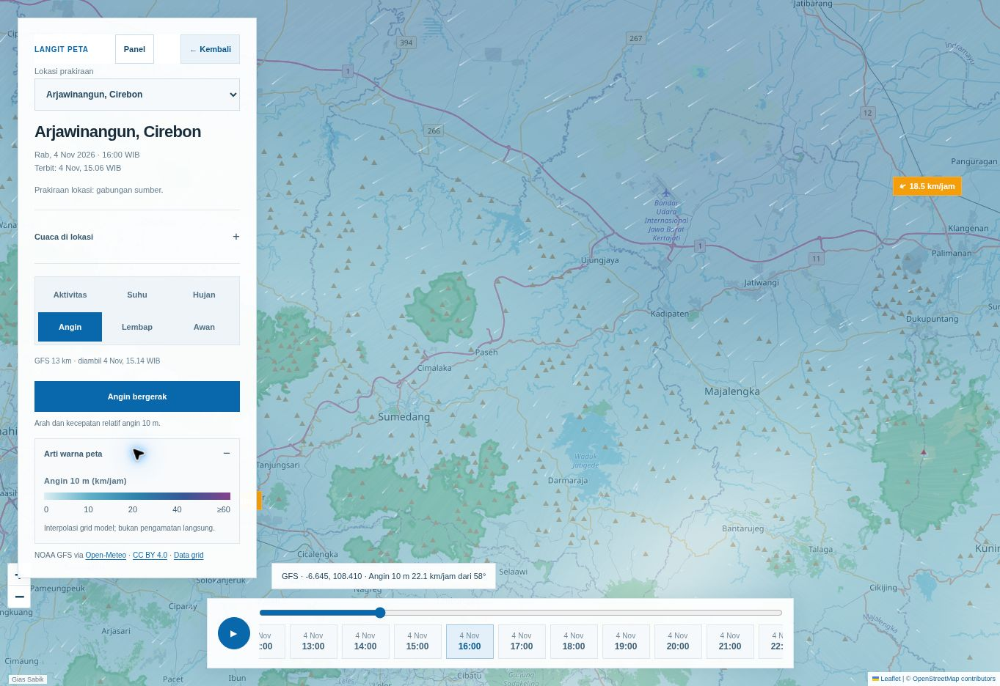

# Verifikasi LANGIT v67

**4 November 2026:** versi v67 telah diterbitkan dan diperiksa di
[website publik](https://marcooo20-d.github.io/weather-forecast/).

Antarmuka memakai tipografi, foto kampus, dan garis pemisah dengan teks yang
lebih singkat. Peta menambahkan grid regional NOAA GFS, jejak angin, pembacaan
nilai pada koordinat, slider waktu, dan panel yang dapat ditutup. Berita BMKG
serta ANTARA memuat tanggal terbit dan filter wilayah. Kredit nama di bagian
bawah berukuran 10 px.

## Sumber dan publikasi

| Bagian | Bukti |
| --- | --- |
| Perubahan utama | [PR #6](https://github.com/Marcooo20-D/weather-forecast/pull/6) |
| Detail per jam | [PR #7](https://github.com/Marcooo20-D/weather-forecast/pull/7) |
| Slider dan publikasi antarmuka | [PR #8](https://github.com/Marcooo20-D/weather-forecast/pull/8) |
| Revisi sumber final | `dda88501dc6c1c6cfbf4a5c8bc118770ae9ab8f7` |
| Prakiraan penuh terakhir | [Run 41795170997](https://github.com/Marcooo20-D/weather-forecast/actions/runs/41795170997), sukses |
| Publikasi antarmuka | [Run 41798128122](https://github.com/Marcooo20-D/weather-forecast/actions/runs/41798128122), sukses |
| GitHub Pages | [Run 41798163003](https://github.com/Marcooo20-D/weather-forecast/actions/runs/41798163003), sukses |
| Commit terbit | `f6c552c57695cc592f0a93503845bc15da515732` |
| Build publik | `2026-11-04T08:15:49.490791+00:00` |

Proses penuh menyelesaikan prakiraan, sinkronisasi observasi, evaluasi,
pengambilan grid GFS 19 × 11 titik untuk 72 jam, dan tiga judul berita.
Publikasi antarmuka berikutnya memakai snapshot tersebut tanpa menghitung
ulang model atau menulis ulang arsip. Jadwal prakiraan penuh tetap berjalan.

## Pengujian

- **74 tes offline lulus**, termasuk preservasi waktu terbit/status ensemble,
  satuan grid, arah u/v, data kosong, umur cache, dan parsing berita.
- **132 pemeriksaan Chromium lulus** pada 1440×900, 768×1024, 390×844, dan
  320×780. Cakupan meliputi grafik, dialog, navigasi, filter berita, lapisan,
  gerak/jeda angin, panel ponsel, slider, serta kegagalan grid dan Leaflet.
- Pemeriksaan pada sumber final juga sukses:
  [offline](https://github.com/Marcooo20-D/weather-forecast/actions/runs/41798128187)
  dan [Chromium](https://github.com/Marcooo20-D/weather-forecast/actions/runs/41798128124).
- Dibandingkan dengan v66 pada input/waktu yang sama: 28 produk data dan
  38.531 nilai numerik, boolean, kosong, serta waktu tanpa perbedaan.
  Seluruh 71 URL HTML dipertahankan.
- Rebuild dari snapshot publik pada waktu build yang sama mempertahankan
  **118.457 nilai dalam 23 JSON/GeoJSON**, tanpa perbedaan setelah mengecualikan
  versi, revisi sumber, dan waktu build.

[Laporan preservasi](verification/v67-preservation.json) mencatat hasilnya.
Mesin prakiraan tetap memiliki blob
`03cbf032a4f2e73764904ce9ff2218bd498e4e4f`.

## Pemeriksaan publik

Pada 08:19 UTC, seluruh **138 berkas HTTP** berstatus 200 dan memiliki SHA
blob yang cocok dengan tree terbit. Tidak ada kegagalan atau pengulangan
permintaan. Marker `.nojekyll` dikecualikan. Hasil unduhan lolos validasi
kontrak data dan tautan, dengan ukuran 5.482.457 byte.

[Laporan HTTP](verification/v67-http.json) menyimpan hasil per berkas.

Browser langsung memperlihatkan nama wilayah dan jalan pada peta, termasuk
Sumedang, Majalengka, Jatiwangi, dan Palimanan, serta atribusi OpenStreetMap.
Grid berstatus siap, jejak angin bergerak dan berhenti saat dijeda. Pembacaan
suhu/hujan pada koordinat, pergantian jam, filter berita, dan nama penulis
diperiksa. Pada versi final, slider bernilai 16 sesuai waktu terpilih
4 November pukul 16.00 WIB. Grid diambil pukul 15.14 WIB.

## Batas

Grid regional memiliki resolusi sekitar 13 km; interpolasi dan animasi bukan
radar atau pengamatan langsung. Prakiraan titik kampus tetap berasal dari
gabungan sumber yang terpisah. Pengujian ini memeriksa integritas data serta
antarmuka dan tidak membuktikan peningkatan akurasi meteorologis. Pengujian
lintas browser dan audit aksesibilitas lengkap belum dilakukan.

Pembangun terdahulu disimpan di `legacy/`. Audit 30 Oktober dipindahkan ke
nama bertanggal; `AUDIT_LATEST.md` kini menunjuk pemeriksaan ini. Arsip
ilmiah, riwayat commit, atribusi pihak ketiga, dan proyek trading dipertahankan.
